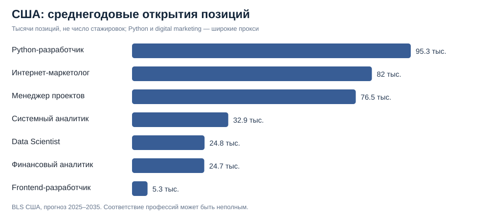
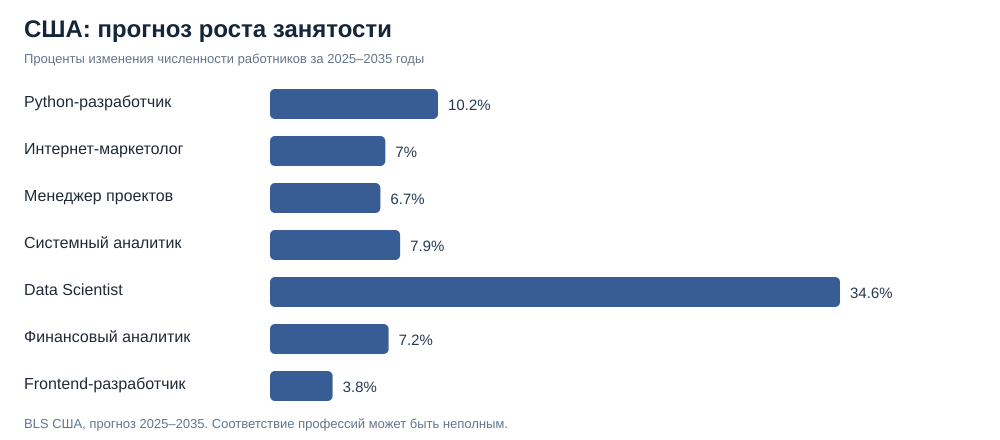

# Исследование выбора профессий для ПРОБЫ — международный и российский срез

**Обновлено:** 18.10.2026. **Предмет:** 12 направлений, 7 кандидатов на расширение.  
**Статус:** выполнен анализ официальной американской статистики и качественный аудит российских описаний junior-навыков; **полное измерение российских стажировок и интереса аудитории остаётся открытым**.

## 1. Исследовательский вопрос

Как выбрать следующие профессиональные пробы так, чтобы они были полезны студентам и выпускникам, реалистично показывали задачи профессии и имели перспективу на рынке труда?

Три понятия НЕ взаимозаменяемы:
- **Спрос работодателей** — занятость, прогноз, вакансии, открывающиеся позиции.
- **Возможность входа** — стажировки и junior-позиции, без требования опыта.
- **Интерес студентов** — поисковые запросы о выборе профессии, выбор проб, прохождения, покупки. Спрос работодателей его не заменяет.

## 2. Сопоставимые официальные данные (США)

Источник: **U.S. Bureau of Labor Statistics, Occupational Projections 2025–2035**, опубликован 27.08.2026. [Таблица 1.2](https://www.bls.gov/emp/tables/occupational-projections-and-characteristics.htm).

За один период и страну доступны показатели занятости в 2025 году, среднегодовых открытий позиций в 2025–2035 и изменения численности занятых.

| Профессия ПРОБЫ | Код SOC и используемая категория BLS | Открытий в год, тыс. | Рост 2025–35 | Качество соответствия |
| --- | --- | ---: | ---: | --- |
| Бизнес-аналитик | 13-1111 Management analysts | 94,1 | 10,1% | частичное |
| UX/UI-дизайнер | 15-1255 Web and digital interface designers | 8,3 | 6,0% | частичное |
| Продакт-менеджер | нет подходящей однозначной категории | — | — | отсутствует |
| QA-инженер | 15-1253 Software quality assurance analysts and testers | 10,7 | 5,7% | близкое |
| Аналитик данных | 15-2031 Operations research analysts | 7,5 | 11,9% | слабое; не подменять профессию |
| Системный аналитик | 15-1211 Computer systems analysts | 32,9 | 7,9% | близкое |
| Финансовый аналитик | 13-2051 Financial and investment analysts | 24,7 | 7,2% | близкое |
| Менеджер проектов | 13-1082 Project management specialists | 76,5 | 6,7% | близкое; включает не-IT |
| Python-разработчик | 15-1252 Software developers | 95,3 | 10,2% | слабое: все языки/стэки |
| Интернет-маркетолог | 13-1161 Market research analysts and marketing specialists | 82,0 | 7,0% | частичное: broader marketing |
| Data Scientist | 15-2051 Data scientists | 24,8 | 34,6% | близкое |
| Frontend-разработчик | 15-1254 Web developers | 5,3 | 3,8% | частичное: категория неполная |

Обозначение «открытия позиций» включает переходы и выход работников из профессии и изменения занятости — **это не вакансии, не стажировки и не уникальные объявления**. Профессии с плохим соответствием SOC **нельзя** считать точно количественно сопоставленными. США не репрезентируют российский рынок.

Сырые исходные значения и ссылки построчно: [CSV](../data/bls_role_mapping_2025_35.csv).

## 3. Требования к стажёрам и junior: российские источники

Для 11 профессий вручную отобраны **22 примера** навыков и заданий из описаний профессий и материалов [hh Карьера](https://career.hh.ru/); у продакт-менеджера подходящая независимая проверенная карточка в этом срезе не найдена.

Примеры:
- **Системный аналитик:** сбор и формализация требований; спецификации и тестирование ([источник](https://career.hh.ru/profession/8)).
- **Финансовый аналитик:** Excel, сценарные модели, ROI и NPV ([источник](https://career.hh.ru/article/finansovyj-analitik-professiya-budushego-ili-net)).
- **Менеджер проектов:** планирование сроков, бюджета и протоколов встреч ([источник](https://career.hh.ru/profession/59)).
- **Интернет-маркетолог:** системы веб-аналитики, воронка и A/B-тестирование ([источник](https://career.hh.ru/article/kto-takoj-internet-marketolog-i-chem-on-otlichaetsya-ot-drugih-marketologov)).
- **Python-разработчик:** функции, скрипты и тестирование ([источник](https://career.hh.ru/profession/50)).
- **Frontend-разработчик:** HTML/CSS/JavaScript, простые компоненты ([источник](https://career.hh.ru/profession/40)).
- **Data Scientist:** предобработка данных, базовые ML-модели, визуализация ([источник](https://career.hh.ru/profession/1)).

Все записи с ссылками и пометкой, что это **качественная подборка, не частотный анализ**, находятся в [CSV](../data/junior_requirements_curated.csv). Из этих данных нельзя делать утверждение «70% вакансий требуют SQL».

## 4. Аналитическая модель: НЕ финальный продуктовый рейтинг

Для 7 кандидатов построен **иллюстративный индекс**: 40% нормализованных по log(1+x) среднегодовых американских открытий позиций + 15% нормализованного роста + 45% **экспертной гипотезы** о простоте создания реалистичных заданий (0–1).

Сценарий демонстрирует расчёты и необходимость анализа неопределённости, **не показывает спрос студентов** и **не считается рейтингом для реального запуска**.

| Кандидат | Индекс, баллы из 100 | Диапазон мест в 9 сценариях веса |
| --- | ---: | ---: |
| Интернет-маркетолог | 84,5 | 1–2 |
| Менеджер проектов | 83,8 | 2–4 |
| Python-разработчик | 80,4 | 1–5 |
| Системный аналитик | 77,0 | 3–5 |
| Финансовый аналитик | 74,3 | 4–6 |
| Data Scientist | 72,7 | 2–6 |
| Frontend-разработчик | 51,5 | 7–7 |

Сценарии: 25/40/55% веса открытий, 10/15/25% роста, остаток — простота моделирования. Частичное и слабое соответствие названий BLS — **отдельный риск сравнения**, не учтённый в формуле; в пользу Python-разработчика и маркетолога это может сильно завысить интерпретацию.

[Данные индекса](../data/candidate_exploratory_index_2026-10-18.csv) · [Код воспроизведения и SQL-проверки](../scripts/analyze_bls_2025_35.py).

## 5. Продуктовое решение: что проверять в первую очередь

**Не нужно объявлять победителем интернет-маркетолога только потому, что он первый в иллюстративном индексе.** Его BLS-категория объединяет больше профессий, чем российский «интернет-маркетолог».

Рекомендуемая последовательность **валидации гипотез**, а не окончательный roadmap:

1. **Системный аналитик.** Достаточно близкое BLS-соответствие; типовые задачи документирования и API; возможно переиспользование части проверенного материала бизнес-аналитика.
2. **Менеджер проектов.** Отдельная профессия от уже реализованного продакт-менеджера; задачи по срокам, статусам, коммуникации, рискам.
3. **Финансовый аналитик.** Практические кейсы по Excel, бюджетированию и оценке решений.
4. **Интернет-маркетолог.** Быстрые измеримые задания по аналитике кампаний — после проверки, что интерес аудитории действительно есть.

Трудоёмкость непосредственного создания материалов может быть небольшой благодаря ИИ. Главные операционные риски — **достоверность сценария, корректность проверки и QA контента**; поэтому сводить CAPEX/OPEX только к генерации текста некорректно.

**Уверенность:** низкая для точного порядка запуска, умеренная для выбора списка на проверку. Причины: нет данных о предпочтениях аудитории, несопоставимые американские/российские рынки, неочищенный российский рынок вакансий.

## 6. Что нужно для окончательного решения

### Российский слой — карьерные возможности
Для одинаковых регионов и даты получить 7 одинаково отфильтрованных запросов стажировок/junior с пометкой: текст запроса, фильтр опыта, район/регион, дата, число совпадений, 10–20 примеров объявлений с ID, чтобы вручную исключить нерелевантные вакансии.

### Пользовательский слой — интерес к профессиям
Получить Wordstat/Google Trends по выбранной стране и периоду, используя запросы вида «как стать системным аналитиком», «стажировка системный аналитик», а также аналогичные для остальных профессий. Учитывать, что поисковая частота ≠ желание купить ПРОБУ.

Сильнее всего — продуктовая аналитика: показы профессий, клики на карточки, регистрации, старт и завершение пробы, оплата после бесплатной. Без такой воронки не доказать пользовательский спрос.

### Проверка чувствительности и пилот
После получения двух слоёв пересчитать веса и провести пилот на студентах. Приоритет определяется не одним индексом, а устойчивостью результатов и фактической конверсией.

**Что завершено уже сейчас:** документированное сравнение официальных BLS 2025–35, качественная карта junior-навыков по источникам, воспроизводимая SQL-агрегация, расчетный индекс со сценариями и рекомендации для следующей проверки.

**Что НЕ завершено:** репрезентативная российская база стажировок, количественная оценка интереса студентов и окончательный продуктовый рейтинг.
