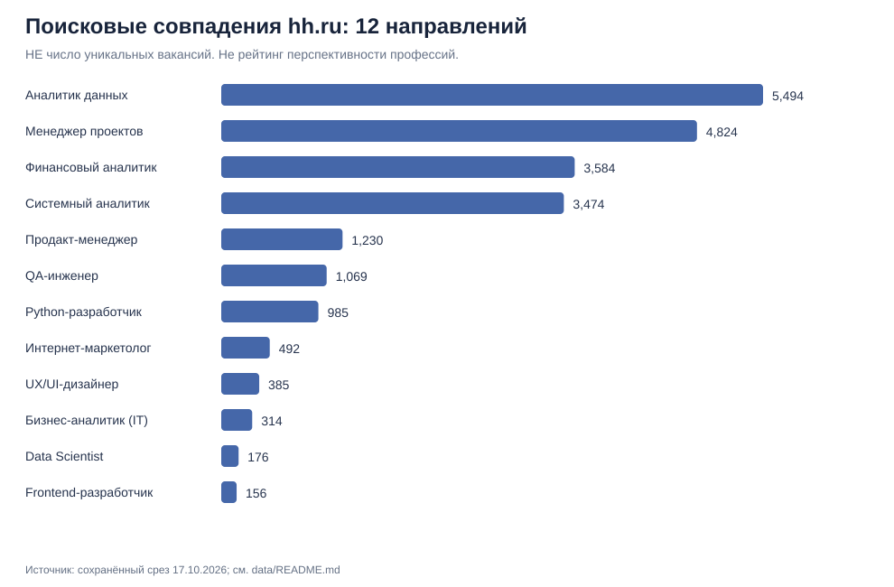
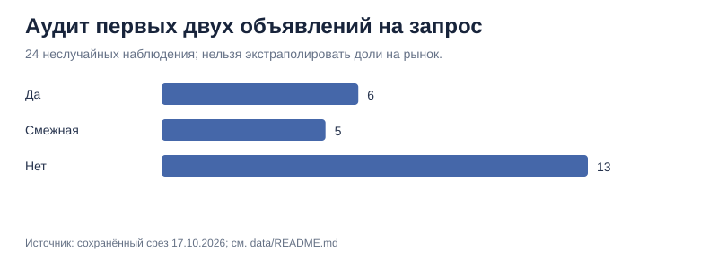

# Результаты предварительного исследования рынка труда

**Дата записанного среза:** 17 октября 2026 года. **География:** Москва. **Источник:** открытые страницы поиска hh.ru.

## Что собрано
- 12 профессиональных направлений, 12 записанных чисел поисковых совпадений.
- 24 первые позиции выдачи (2 на направление), вручную отнесённые к одной из категорий релевантности.
- 19 примеров профессиональных требований из поисковых фрагментов в рабочем исследовании; они **не** используются здесь для оценки частоты навыков, так как не представляют репрезентативную выборку.

## Визуализация 1 — поисковые совпадения

Значения отсортированы по величине, но **не** являются количеством уникальных вакансий или доказательством спроса студентов. В выдачу по профессии могли попасть другие должности, одни и те же вакансии могли встречаться в нескольких поисках, а метод поиска не сводился к точному названию.

## Визуализация 2 — качество выдачи

Из первых двух позиций каждого запроса (n=24): **6** отмечены как соответствующие, **5** — смежные, **13** — нерелевантные. Это не оценка общей точности hh.ru, поскольку выборка не была случайной и представляет только верх выдачи.

## Что можно заключить

**Факт:** сырые поисковые совпадения загрязняются нерелевантными должностями. Для формирования рейтинга профессий необходимы классификация названий, работа с ID вакансий, дедупликация и одинаковые фильтры по регионам, времени и уровню опыта.

**Ограничение:** поиск стажировок, Wordstat и изучение поведения аудитории пока не завершены. Поэтому окончательный рейтинг профессий для ПРОБЫ **не рассчитан**.

**Дальнейшее решение:** собрать унифицированные данные по стажировкам и junior-позициям, затем отдельно измерить пользовательский интерес и подготовить чувствительный к весам рейтинг. Это задача следующего этапа.

## Воспроизводимость

- [Исходные числа](../data/hh_search_snapshot_2026-10-17.csv)
- [Аудит объявлений](../data/listing_quality_audit_2026-10-17.csv)
- [Методические оговорки](../data/README.md)
- [Код обработки и графиков](../scripts/analyze_snapshot.py)

Запуск: `pip install -r requirements.txt && python scripts/analyze_snapshot.py`.
