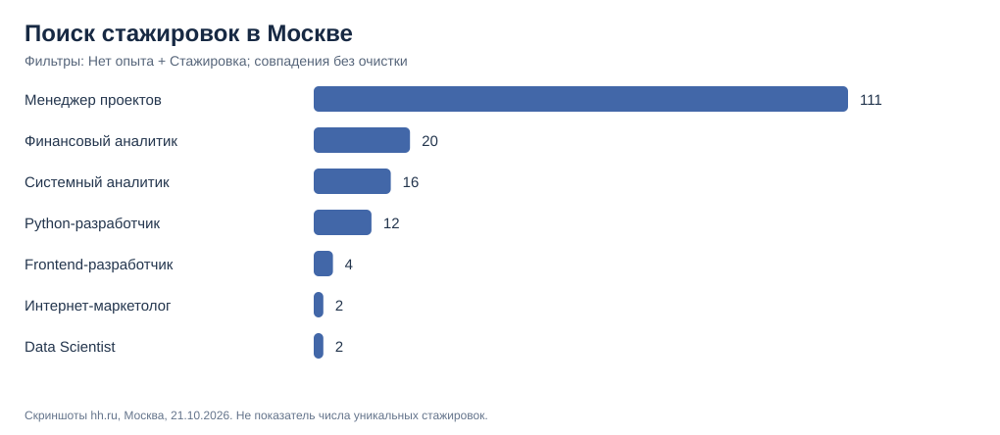
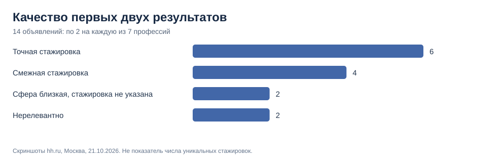

# Стажировки в Москве: единый срез поисковой выдачи hh.ru

**Дата получения скриншотов:** 21 октября 2026 года (по именам загруженных файлов).  
**Источник:** шесть скриншотов поисковых страниц hh.ru, предоставленных для исследования.  
**География:** Москва. **Фильтры:** «Нет опыта» + «Стажировка». **Период:** «За всё время».  
**Примечание:** текст запроса — название профессии, без обязательного слова «стажёр». Числа относятся к результатам поискового интерфейса и не очищены от пересечений и нерелевантных ролей.

## 1. Зафиксированные результаты

| Запрос | Совпадений в поиске | Два примера выдачи: точные / смежные стажировки / прочее |
| --- | ---: | --- |
| менеджер проектов | 111 | 0 / 1 / 1 |
| финансовый аналитик | 20 | 1 / 1 / 0 |
| системный аналитик | 16 | 2 / 0 / 0 |
| Python-разработчик | 12 | 0 / 2 / 0 |
| frontend-разработчик | 4 | 2 / 0 / 0 |
| интернет-маркетолог | 2 | 0 / 0 / 2 |
| Data Scientist | **нет данных** | скриншот не предоставлен |

По шести запросам получено 165 **поисковых совпадений в сумме**. Это число **нельзя** называть общим количеством уникальных стажировок: вакансии могут повторяться между запросами.



## 2. Ручная проверка первых двух результатов

Проанализированы первые две видимые карточки каждого запроса (12 наблюдений):

- **5** — стажировка непосредственно по названной профессии;
- **4** — смежная стажировка, но по другой роли;
- **2** — должности близкой сферы без явного указания стажировки в заголовке;
- **1** — нерелевантная профессия.



Примеры важных расхождений:
- В выдаче «менеджер проектов» обнаружены «Скаут менеджер» и стажёр **продуктового** менеджера; **Product Manager и Project Manager — разные профессии**.
- В выдаче «Python-разработчик» видны стажёр ML-инженера и стажёр RPA-разработчика. По заголовкам **нельзя подтвердить**, что обе вакансии обучают именно Python-разработке.
- В выдаче «финансовый аналитик» есть стажёр в отдел финансовой аналитики и стажёр казначейства — вторая роль смежная.
- У «интернет-маркетолога» две карточки похожих маркетинговых ролей, но заголовки не содержат явного указания на стажировку. Наличие фильтра на странице **не позволяет доказать по одному заголовку**, что это полноценная стажировка.
- У системного аналитика и frontend-разработчика первые две карточки обозначены как стажировки искомых профессий.

**Критически важно:** первые 2 позиции ранжированы алгоритмом hh.ru, а не отобраны случайно. Поэтому 5/12 — **не процент точных стажировок по всем 165 поисковым совпадениям** и не характеристика точности поиска hh.ru вообще.

## 3. Как меняются продуктовые выводы

Сырой показатель 111 для менеджера проектов **не подтверждает 111 профильных стажировок**. Одновременно по этой профессии есть дополнительное свидетельство карьерного интереса студентов в [Changellenge BCA 2026](../data/changellenge_student_interests_2026.csv) (в группе менеджмента).

Для **системного аналитика** обнаружены два прямых примера стажировок и сравнительно близкая зарубежная статистическая категория. Это поддерживает его дальнейшую проверку, но не доказывает превосходство по объёму рынка.

**Финансовый аналитик** подтверждает наличие финансовых стажировок, однако часть выдачи включает смежное казначейство. **Frontend** имеет мало поисковых совпадений при двух прямых примерах стажировок — интерпретировать это как слабый студенческий интерес нельзя.

**Промежуточное решение:** оставить в коротком списке для пилота **менеджера проектов, системного аналитика и финансового аналитика**. До измерения пользовательского спроса и очистки всей выдачи не публиковать формальный итоговый рейтинг.

## 4. Степень доказательности

- **Высокая:** на скриншотах действительно указаны шесть счётчиков с общими фильтрами; названия видимых карточек переписаны из изображений.
- **Умеренная:** классификация первых двух карточек по заголовкам (не прочитаны полные тексты обязанностей).
- **Низкая:** выводы о сравнительной доступности **всех** стажировок и о предпочтениях будущих покупателей ПРОБЫ.

### Что ещё нужно получить

1. Скриншот такого же поиска **Data Scientist**: Москва, «Нет опыта», «Стажировка», «За всё время», с числом результатов и двумя первыми вакансиями.
2. Позднее — уникальные URL/ID и описания вакансий, в идеале 10–20 на профессию, чтобы определить реальную релевантность и требования.
3. Отдельно — интерес к профессиям (исследование студентов, Wordstat и продуктовые события). Он не равен числу стажировок.

## 5. Данные и воспроизводимость

- [Поисковые счётчики и параметры](../data/hh_internships_moscow_2026-10-21.csv)
- [Классификация первых двух вакансий](../data/hh_internship_first_two_audit_2026-10-21.csv)
- [Агрегированная таблица](../data/hh_internship_search_aggregate_2026-10-21.csv)
- [Python-скрипт с проверками данных и генерацией двух графиков](../scripts/analyze_ru_internships.py)

```bash
python scripts/analyze_ru_internships.py
```

**Снимки экрана не публикуются в публичном репозитории**; происхождение каждой строки привязано к имени переданного файла. Из-за отсутствия ID вакансий эти заголовки нельзя надёжно перепроверить на hh.ru спустя время.
