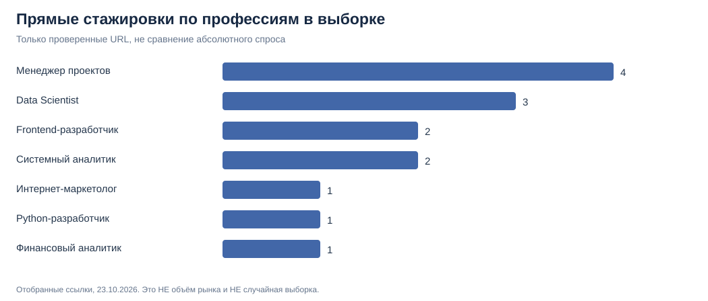

# Проверяемые требования работодателей: следующий этап исследования ПРОБЫ

**Дата изучения источников и дополнительного аудита: 23.10.2026.** Предмет — 7 профессий, которые рассматривались для расширения ПРОБЫ.

## 1. Что добавлено

В дополнение к поисковому срезу hh.ru от 21.10.2026 собрана отдельная **целевая качественная выборка из 16 URL конкретных объявлений** на официальных карьерных страницах и профессиональных сервисах вакансий. **При последующей независимой повторной проверке 14 страниц доступны для чтения; 2 страницы не открылись, поэтому их текст остаётся неподтверждённым повторно.**

| Профессия | Отобрано карточек | Точное совпадение | Смежные | Разных работодателей |
| --- | ---: | ---: | ---: | ---: |
| Менеджер проектов | 4 | 4 | 0 | 2 |
| Data Scientist | 3 | 3 | 0 | 2 |
| Интернет-маркетолог | 3 | 1 | 2 | 3 |
| Frontend-разработчик | 2 | 2 | 0 | 2 |
| Системный аналитик | 2 | 2 | 0 | 2 |
| Python-разработчик | 1 | 1 | 0 | 1 |
| Финансовый аналитик | 1 | 1 | 0 | 1 |
| **Всего** | **16** | **14** | **2** | **число в последнем столбце нельзя суммировать** |

**Выборка удобства, а не случайная выборка рынка**: публиковались только те позиции, для которых удалось прочитать описание и сохранить отдельный адрес. Список не исчерпывает вакансии hh.ru, в него входят несколько дублей направлений по одной группе работодателей. **Количество карточек по строкам показывает работу исследователя по сбору ссылок, а не востребованность профессий.**



## 2. Подтверждённые навыки — только внутри этой выборки

Скрипт считает **количество разных объявлений**, в которых вручную отмечен конкретный навык. Нельзя использовать частоты как долю по российскому рынку.

| Профессия | Примеры обнаруженных навыков в точных объявлениях |
| --- | --- |
| Менеджер проектов (n=4) | Координация — 4/4; коммуникация — 3/4; контроль сроков — 2/4 |
| Data Scientist (n=3) | Python — 3/3; ML — 3/3; SQL — 2/3 |
| Frontend-разработчик (n=2) | TypeScript — 2/2; Vue — 2/2; REST API — 2/2; Git — 2/2 |
| Системный аналитик (n=2) | Работа с требованиями — 2/2; BPMN, UML, SQL и REST API присутствуют в одном из двух |
| Финансовый аналитик (n=1) | Excel, финансовое моделирование, подготовка презентаций |
| Python-разработчик (n=1) | Python, Go, работа с аналитическими библиотеками |
| Интернет-маркетолог (n=1 точное совпадение) | GA4, Яндекс Метрика, A/B-тестирование, метрики рекламных кампаний |

Частоты показаны **по вручную размеченным описаниям**, а не получены автоматическим NLP-поиском по корпусу вакансий. Позиции с тегом `adjacent` исключены из частот. Понятия «требуется», «будет плюсом» и «задача» в некоторых источниках могут различаться; текущая таблица не является матрицей обязательности требований.

## 3. Примеры источников

- [Электронная Москва — стажёр системного аналитика](https://nesiditsa.ru/vacancy/138562554): BPMN/UML, спецификации и интеграции; **отклик завершился 21.10.2026**, нельзя считать открытой вакансией на 23.10.
- [Б1 — системный аналитик-стажёр](https://www.b1.ru/vacancies/internship/sistemnyy-analitik-stazher-gruppa-tsifrovizatsii-uchetnykh-funktsiy/): профильная стажировка.
- [ASPACE — младший финансовый аналитик/стажёр](https://ru.joblum.com/job/mladsij-finansovyj-analitik-stazer/34391166): финансовые модели, Excel, инвестиционные расчёты.
- [Яндекс — стажёр менеджера проектов](https://h.careers/job/ae3cce46-4a37-4bdc-8459-f5a2f94608d2): статусы, сроки, исследования рынков и документы встреч.
- [Это Легко — интернет-маркетолог-стажёр](https://h.careers/job/bf1c12cf-cf24-42bc-bf57-39de844c27a1): рекламная аналитика, тестирование гипотез, CTR/CPL и веб-метрики.
- [Туту — стажёр Python](https://youngjunior.ru/python/jobs/68293): Python-отчёты и Go-сервисы; смешанная технологическая роль.
- [Ozon Tech — стажёр Frontend](https://ozon.tech/vacancies/60da37ac-7aa5-43d6-b048-aeb1990edfbb/): Vue, TypeScript, API и Playwright.
- [Ozon Tech — стажёр Data Scientist](https://ozon.tech/vacancies/d33ba8a1-97a7-452b-a5f4-6355f75e335f-stazhior-data-scientist-formirovanie-lent/): ML, Python, Pandas, SQL и рекомендации.

**Аудит доступности ссылок: [CSV](../data/source_audit_2026-10-23.csv) — 14 доступных для чтения страниц, 4 явно архивные, 1 с истёкшим сроком отклика, 2 недоступные для повторного открытия. Эти статусы пересекаются и не должны складываться как взаимоисключающие категории.**

Полные **16 адресов** с пометкой `official_employer` или `job_mirror`, классификацией и датой проверки доступны в [сыром CSV](../data/verified_entry_roles_2026-10-23.csv). Не следует считать отсутствие пометки `archived` подтверждением, что работодатель продолжает принимать заявки.

## 4. Критические ограничения

1. **Смещение по работодателям.** Три изученных Data Scientist-объявления относятся к Ozon Банку / Ozon Tech. Их совпадающие навыки **не являются доказательством предпочтений трёх независимых работодателей**.
2. **Смещение по доступности описаний.** У финансового аналитика и Python-разработчика — по одному источнику. Частотный анализ для них фактически невозможен.
3. **Смешанная география.** Есть московские и опубликованные для РФ удалённые позиции. Их нельзя использовать для перерасчёта московских поисковых счётчиков hh.ru.
4. **Разные уровни.** Включены стажировки и одна junior-позиция — они сохранены в разных значениях `entry_type`.
5. **Ссылки могут устареть.** Некоторые объявления архивные; дата проверки источника не является датой публикации или гарантией открытого набора.
6. **Семантическая неоднородность.** Названия навыков нормализованы вручную, и `coordination` — не тот же тип навыка, что `Python`. Необходимо вводить тип требования (hard skill, инструмент, задача), если строить точные частоты.
7. **Независимая пользовательская ценность.** Ни один показатель в этом файле не измеряет интерес студентов к ПРОБЕ или готовность платить.

**Следствие:** нельзя превращать этот CSV в «рейтинг самых востребованных профессий» или вставлять 4/4 и 3/3 в резюме без пояснения дизайна выборки.

## 5. Что изменилось в продуктовой оценке

Предыдущий срез hh.ru выявил 2 результата Data Scientist и 4 frontend по ограниченному запросу. Дополнительный поиск обнаружил профильные карточки на карьерных сайтах, в том числе Ozon Tech. Поэтому **низкое число совпадений по узкому hh-запросу нельзя трактовать как отсутствие карьерных возможностей**.

На текущих данных по-прежнему разумно тестировать **системного аналитика, менеджера проектов и финансового аналитика** как продуктовые гипотезы. **Но нет доказательств, что они строго превосходят frontend, Python или Data Scientist по студенческому спросу.**

### Отдельно: идеи практических проб

На основе текстов объявлений составлены [сценарии и проверяемые результаты](proba-task-mapping-from-vacancies.md). Это **рекомендации для разработки**, не готовые задания в продакшене.

## 6. Воспроизведение

```bash
python scripts/analyze_verified_entry_roles.py
```

Скрипт использует только стандартную библиотеку Python и SQL через SQLite. Создаёт:

- [Сводную таблицу покрытия](../data/verified_role_coverage_2026-10-23.csv)
- [Частоты нормализованных навыков](../data/verified_skill_frequency_2026-10-23.csv)
- [SVG-график отобранных объявлений](../visualizations/verified_entry_roles_sample_2026-10-23.svg)

Числа в текущих CSV перепроверены по входным строкам. **Автоматическая проверка Python-скрипта и структуры CSV настроена в [.github/workflows/verify-research.yml](../.github/workflows/verify-research.yml).** Этот CI проверяет расчёты и формат данных, но **не** гарантирует, что внешние вакансии доступны или принимают отклики.

## 7. Дальнейшая работа для окончательного рейтинга

Нужно: (a) стабильно выгрузить уникальные ID или URL и полные описания вакансий по единым фильтрам; (b) собрать отдельный опрос или продуктовые события интереса к профессиям; (c) оценить сложность и качество реалистичных проб; (d) задать обоснованные веса и проверить чувствительность. До этого балльный рейтинг остаётся только сценарным инструментом.

**Уверенность:** высокая в арифметике 16 сохранённых строк, умеренная в независимой проверяемости содержания (2 URL недоступны при повторном запросе), низкая — в оценке объёма рынка и точном порядке профессий.
