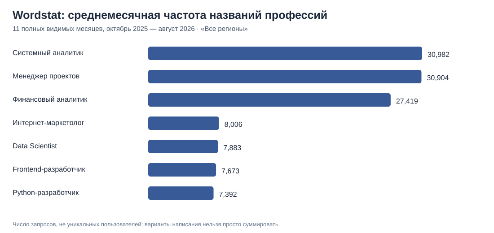

# Wordstat: поисковая популярность семи профессий — первый сопоставимый срез

**Дата переноса данных:** 26.10.2026. **Период видимых показателей:** октябрь 2025 — август 2026, **11 месяцев**. **В интерфейсе на каждом скриншоте выбран фильтр «Все регионы» и все типы устройств.** На всех восьми изображениях сентябрь 2026 в таблице обрезан; за сентябрь значение **не получено**, а не равно нулю.

## 1. Постановка задачи

Для ПРОБЫ нужно определить, какие направления потенциальные пользователи чаще ищут и какие стоит дальше проверять как кандидатов на профессиональные пробы. Сначала используются **широкие названия профессий**, а не малочастотные «как стать...».

Это измеряет **частоту поисковых запросов**, но не число уникальных людей, не обязательно студентов и не вероятность покупки ПРОБЫ.

## 2. Рейтинг по буквальным широким фразам

| Позиция | Фраза Wordstat | Сумма за 11 месяцев | Среднее за месяц | Окт 2025 → авг 2026 |
| ---: | --- | ---: | ---: | ---: |
| 1 | `системный аналитик` | **340 806** | 30 982 | −28,0% |
| 2 | `менеджер проектов` | **339 946** | 30 904 | −53,4% |
| 3 | `финансовый аналитик` | **301 612** | 27 419 | −23,8% |
| 4 | `интернет маркетолог` | 88 064 | 8 006 | −52,7% |
| 5 | `data scientist` | 86 708 | 7 883 | −55,3% |
| 6 | `фронтенд разработчик` | 84 401 | 7 673 | −53,7% |
| 7 | `python разработчик` | 81 309 | 7 392 | −40,2% |



**Техническая точность:** суммы пересчитываются из **77 месячных значений** (7 фраз × 11 видимых месяцев), а не извлекаются приблизительно из графика. Восемь скриншотов включают **88 наблюдений**: дополнительный синоним «пайтон разработчик» даёт 11 отдельных значений и не входит в основной рейтинг.

### Минимальная разница лидеров

Разница между первыми двумя — **860 поисков за 11 месяцев** (около **0,25%** от показателя системного аналитика). Их следует считать практически равными по этому прокси. Нельзя обосновать очередность запуска разницей в 860 запросов с учётом неоднозначности фраз и поискового шума.

### Третья позиция

«Финансовый аналитик» имеет более **301 тыс.** запросов в 11-месячном срезе и находится намного ближе к двум лидерам, чем к остальным четырём фразам. Поэтому не следует исключать эту профессию из пилотных кандидатов.

### Дополнительное написание Python

Фраза `пайтон разработчик` отдельно дала **28 477** запросов за 11 месяцев, или около 2 589 в месяц. **Не прибавлять** к 81 309 для `python разработчик`: широкий поиск может пересекаться, а другие языковые варианты ещё не сопоставлены.

### Динамика: почему нельзя говорить о падении рынка

От октября 2025 к августу 2026 показатели снизились для всех семи буквальных фраз. Однако сравнение только двух месяцев смешивает сезонность, структуру запросов и возможный тренд. Это **не** доказательство ухудшения карьерных перспектив профессий, спроса работодателей или общего снижения интереса студентов.

## 3. Сопоставление с предыдущим карьерным исследованием

| Направление | Широкий Wordstat | Ранний hh.ru-срез по стажировкам, Москва | Что можно заключить |
| --- | ---: | ---: | --- |
| Системный аналитик | 340 806 | 16 поисковых совпадений | Высокая относительная популярность поисковой фразы; есть прямые примеры стажировок |
| Менеджер проектов | 339 946 | 111 совпадений, часть выдачи нерелевантна | Высокая популярность фразы и независимый сигнал из опроса студентов, но не 111 профильных стажировок |
| Финансовый аналитик | 301 612 | 20 совпадений | Существенная популярность фразы; требования работодателей нуждаются в расширении выборки |
| Интернет-маркетолог | 88 064 | 2 совпадения | Частота ниже у конкретного написания, но широкий маркетинг не измерен |
| Data Scientist | 86 708 | 2 совпадения | Есть реальные стажировки вне узкой выдачи hh.ru; нужны альтернативные формулировки |
| Frontend-разработчик | 84 401 | 4 совпадения | Есть прямые стажировки; «frontend» по-английски пока не измерен |
| Python-разработчик | 81 309 | 12 совпадений | Вариант «пайтон» найден отдельно; итоговая оценка направления по одному названию неполна |

**Строго:** нельзя складывать, усреднять или стандартизировать показатели Wordstat и hh.ru без заранее обоснованной нормализации и проверки качества. Первый показатель — частота поисковой фразы с фильтром «Все регионы», второй — совпадения вакансий по Москве с фильтром стажировки. Их знаменатели принципиально разные.

## 4. Продуктовое решение

**Обновлённая рекомендация для пилотов:**

1. **Системный аналитик и менеджер проектов — два кандидата первой волны, без установленного внутреннего приоритета.** Их поисковые частоты практически равны. Дополнительно есть подтверждённые примеры карьерных задач, а для менеджера проектов — частичный внешний опрос профессиональных предпочтений студентов.
2. **Финансовый аналитик — полноценный третий кандидат**, а не запасная роль «на всякий случай». По данному поисковому прокси он значительно ближе к лидерам, чем к остальным кандидатам.
3. Остальные направления **не исключать**: их позиции чувствительны к синонимам и типам поиска. Сравнение с учётом английских/русских вариантов, намерения учиться и желания пройти стажировку ещё не проведено.

**Confidence:** высокий для арифметики 77 наблюдений в основных фразах; умеренный для относительной популярности именно записанных названий; низкий для окончательного бизнес-приоритета и ожидаемого числа оплат.

## 5. Ограничения и воспроизводимость

1. **География:** интерфейс «Все регионы», **не** отдельно Россия. В старом основном шаблоне есть строки для России; их нулевые или пустые значения нельзя заменять новыми значениями без указания региона.
2. **Время:** 11 видимых месяцев вместо исходно запланированных 12; сентябрь оставлен пустым, данные нельзя выдавать за полный год.
3. **Варианты слов:** `data scientist` vs `дата сайентист`, `фронтенд` vs `frontend`, `интернет маркетолог` vs `digital маркетолог`, `python` vs `пайтон`; один вариант не равен всему направлению.
4. **Поисковая семантика:** широкие фразы включают вопросы о зарплате, описания профессии, работающих специалистов, вакансии и прочее.
5. **Доказательность:** оригинальные восемь скриншотов **не размещены публично**; CSV воспроизводит видимые числовые строки и фиксирует имя каждого источника. Не является официальной API-выгрузкой.
6. **Конкурирующие интересы:** программирование имеет множество информационных синонимов без слова «разработчик». Из этого рейтинга нельзя делать вывод, что в целом Python менее популярен, чем интернет-маркетинг.

### Артефакты

- [Поместные месячные значения из 8 скриншотов](../data/wordstat_broad_monthly_2026-10-26.csv) — 96 строк, из которых 88 измерены, 8 помечены отсутствующими.
- [Итог по 7 основным названиям](../data/wordstat_broad_11m_summary_2026-10-26.csv).
- [Python-скрипт пересчёта и графика](../scripts/analyze_wordstat_broad_2026_10.py) (стандартная библиотека).
- [Новая методика трёх слоёв интереса](interest-data-collection.md).

Запуск:

```bash
python scripts/analyze_wordstat_broad_2026_10.py
```

## 6. Остаток для окончательного исследования

Для **ранжирования поисковой популярности буквальных фраз** этот этап уже достаточен и выполнен по одинаковым условиям. Для **окончательной приоритизации ПРОБЫ** всё ещё нужны: (а) проверка важнейших русских и английских синонимов; (б) поиск интереса к **обучению и стажировке**; (в) поведенческий тест «Хочу попробовать» на платформе; (г) финальная проверка стоимости QA и релевантности реальных стажировок. Временной ряд за сентябрь нужен только для полной 12-месячной модели.
