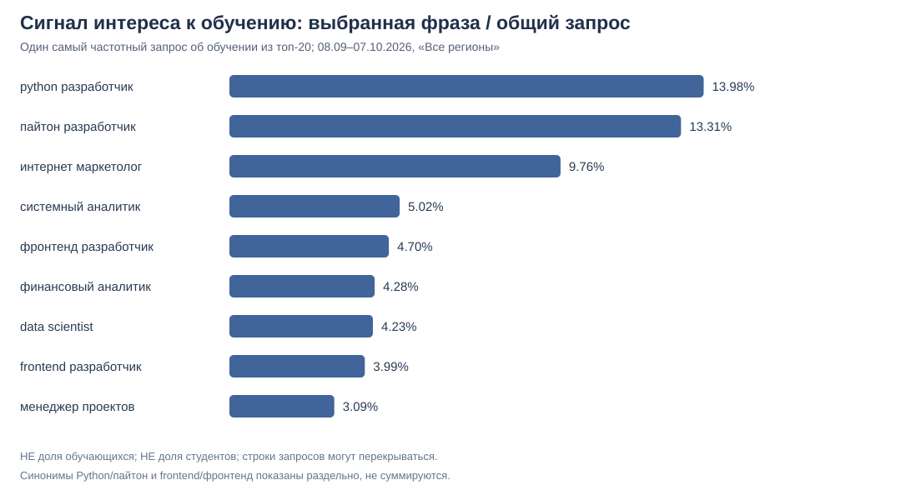

# Wordstat: поисковые намерения по семи профессиям

**Дата передачи источников:** 26.10.2026.  
**Источник:** 9 пользовательских скриншотов вкладки «Топы запросов» Яндекс Wordstat.  
**Период каждого скриншота:** **08.09.2026 — 07.10.2026** (30 календарных дней).  
**Фильтры:** «Все регионы», десктопы + смартфоны + планшеты.  
**Статус:** первичный классификационный срез, **не исследование репрезентативной доли будущих покупателей ПРОБЫ**.

## 1. Что собрано и как обрабатывалось

- 9 исходных формулировок по 7 профессиям: для Python (`python`/`пайтон`) и Frontend (`frontend`/`фронтенд`) есть по две версии.
- **180 видимых строк** — 20 запросов на каждом из девяти скриншотов, с отдельной частотой и вручную присвоенной основной категорией: обучение, поиск работы, стажировка, заработок, ознакомление с профессией и др.
- Воспроизводимый [Python + SQLite анализ](../scripts/analyze_wordstat_top_queries.py): проверка размера и источников, SQL оконная функция для выбора **одной максимальной видимой фразы в каждой категории**, сохранение данных и SVG.

**Нельзя складывать строки топов.** Например, `курсы системного аналитика` и `системный аналитик курсы` на скриншоте имеют **одинаковые 1 759**: это перестановки похожих запросов, не независимые пользователи. Запрос `python разработчик` и `пайтон разработчик` также может пересекаться с вариантами слов; объёмы вариантов следует держать раздельно.

## 2. Самые сильные отдельные сигналы из видимых топ-20

| Основной поисковый термин | Все запросы по термину, 30 дней | Наиболее частотная видимая фраза об обучении | Её частота | Соотношение с основным термином |
| --- | ---: | --- | ---: | ---: |
| `системный аналитик` | 35 024 | курсы системного аналитика | 1 759 | 5,02% |
| `финансовый аналитик` | 33 203 | курсы финансового аналитика | 1 422 | 4,28% |
| `менеджер проектов` | 26 892 | менеджер проектов обучение | 831 | 3,09% |
| `интернет маркетолог` | 6 621 | курсы интернет маркетолога | 646 | 9,76% |
| `фронтенд разработчик` | 6 909 | курсы фронтенд разработчика | 325 | 4,70% |
| `frontend разработчик` | 4 187 | frontend разработчик обучение | 167 | 3,99% |
| `python разработчик` | 6 182 | курсы python разработчик | 864 | 13,98% |
| `пайтон разработчик` | 2 246 | пайтон разработчик обучение | 299 | 13,31% |
| `data scientist` | 5 700 | data scientist обучение | 241 | 4,23% |



**Что означает процент:** частота **одной выбранной фразы** делённая на частоту исходного термина за один и тот же интервал/регион/устройства. Это **не доля людей, желающих учиться**, не полная доля учебных запросов и не вероятность покупки. Другие учебные формулировки пересекаются, в том числе с выбранной фразой, и отсутствующая ниже 20-го места формулировка не равна нулю.

### Отдельно: старт карьеры

Самый частотный **явно стажёрский** запрос в видимом топ-20:

| Термин | Формулировка | Частота за 30 дней |
| --- | --- | ---: |
| системный аналитик | стажировка системный аналитик | 1 028 |
| менеджер проектов | стажер менеджер проектов | 280 |
| фронтенд разработчик | стажировка фронтенд разработчик | 129 |
| frontend разработчик | стажировка frontend разработчик | 117 |
| python разработчик | стажировка python разработчик | 121 |
| пайтон разработчик | стажировка пайтон разработчик | 46 |
| data scientist | data scientist стажировка | 65 |
| финансовый аналитик | нет среди видимых топ-20 | — |
| интернет маркетолог | нет среди видимых топ-20 | — |

**Отсутствие в топ-20 — не нулевой интерес.** Например, поиск с другой словоформой `стажёр финансового аналитика` может быть ниже отсечения или не входить в эту подборку.

## 3. Конкретные свидетельства неоднородности

- **Системный аналитик:** частота `день системного аналитика` — **2 557**. Она может отражать инфоповод/праздник и делает полный объём термина шумным показателем долгосрочной профессии.
- **Менеджер проектов:** `менеджер строительного проекта` — **749**. Общая фраза охватывает не только IT-проекты, поэтому её нельзя считать мерой популярности IT-профессии.
- **Финансовый аналитик:** `владимир левченко финансовый аналитик` — **938**. Часть интереса может относиться к конкретному человеку, а не выбору специальности.
- **Python:** `ты нищий пайтон разработчик` — **137** и мемовая форма `ты нищий пайтон разработчик мем` — **19**; это явно не карьерные запросы.
- **Frontend:** русская и латинская формы имеют собственные топы и объёмы; нельзя просто сложить 6 909 и 4 187, поскольку нет проверки пересечения.
- **Финансовый и системный аналитик:** грамматические перестановки с **одинаковой частотой** (например, `финансовая аналитика` и `финансовый аналитик` — 32 774) не означают вдвое больший объём интереса.

## 4. Что изменилось относительно прежнего рейтинга Wordstat

**Не изменилось:** широкие 11-месячные названия из [предыдущего отчёта](wordstat-broad-results-2026-10-26.md) указывают на сравнительно высокую частоту системного аналитика, менеджера проектов и финансового аналитика.

**Уточнилось:** интерес к **конкретной фразе об обучении** относительно основной фразы заметен у Python-разработчика и интернет-маркетолога. Это аргумент **не исключать** их из тестирования даже при более низком широком объёме. Но это **не доказательство более высокой конверсии в ПРОБУ**. Итоговый порядок разработки от этих данных не следует менять без продуктового эксперимента.

**Данные не объединяются**: предыдущая динамика охватывала октябрь 2025 — август 2026 (11 видимых месяцев), новые топы — 08.09–07.10.2026 (30 дней). Границы окон разные. Обе выборки используют «Все регионы», что не является изолированной оценкой России.

## 5. Продуктовое решение

**Пилотная гипотеза сохраняется:** системный аналитик и менеджер проектов — первая пара для проверки, финансовый аналитик — следующий кандидат.

Для решения о массовом запуске нужны два последующих шага:

1. Собрать **реальный продуктовый сигнал**: в одинаково показанном каталоге семи профессий дать выбрать «Хочу попробовать» и сравнить доли заинтересованных по количеству уникальных показанных сессий. Не обещать доступность ещё не созданной пробы.
2. Проверить **качество контента и экономику** (экспертный QA, стоимость поддержки, воронку начала/завершения и оплат). Нельзя посчитать ROI из поисковых частот.

**Уверенность:** высокая в расчёте по видимым 180 строкам; умеренная в ручной классификации строк по написанию без полного контекста поиска; низкая в прогнозе спроса/покупок.

## 6. Данные и ограничения

- [180 запросов, 9 источников, категории](../data/wordstat_top_queries_2026-10-26.csv).
- [Неаддитивные показатели по каждому термину и намерению](../data/wordstat_intent_signals_2026-10-26.csv).
- [Скрипт Python / SQLite](../scripts/analyze_wordstat_top_queries.py).
- [График сигнала запросов об обучении](../visualizations/wordstat_learning_signal_2026-10-26.svg).

```bash
python scripts/analyze_wordstat_top_queries.py
```

**Ограничения:** это только первые 20 строк выдачи по каждому термину, а не вся структура поисковых запросов. Категории вручную назначены по формулировкам и не обязательно однозначны; источники — пользовательские скриншоты без публичной выкладки изображений. Отсутствие поисковой фразы в этом списке — не свидетельство отсутствия интереса. Действующий пользователь, рекрутер и студент не различимы по частотностям.
